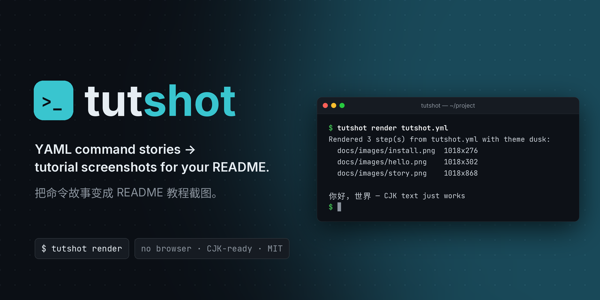
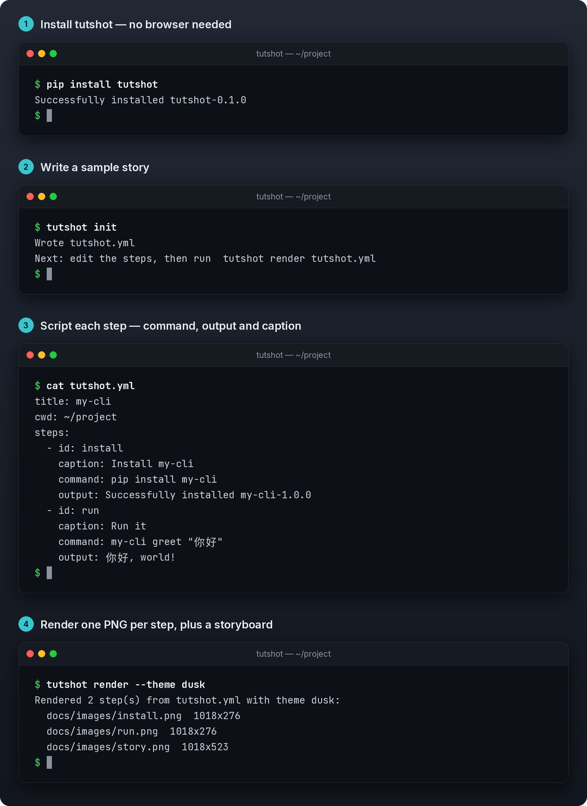
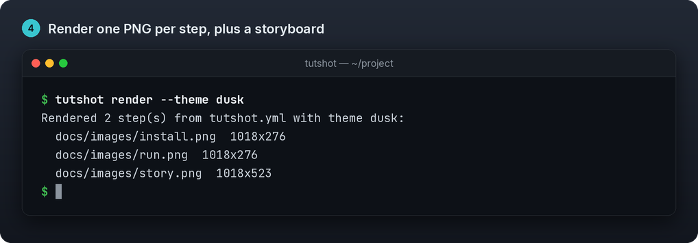
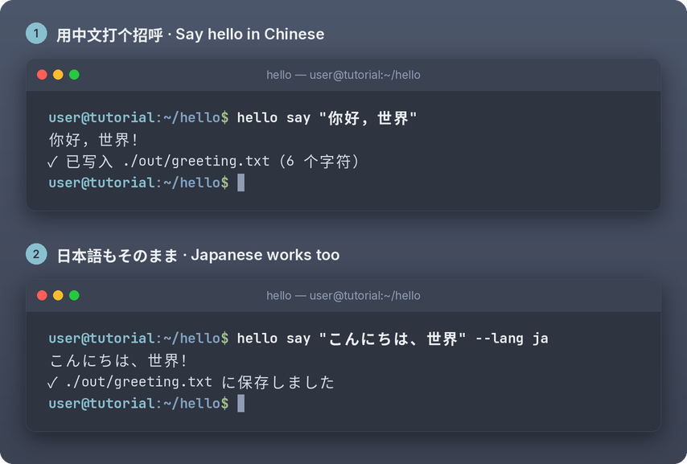
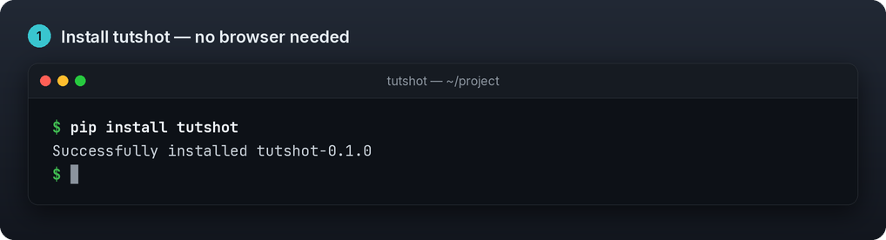
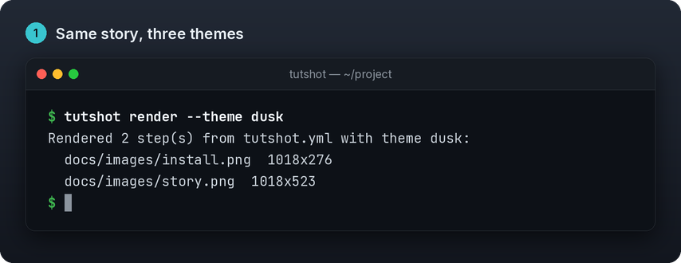
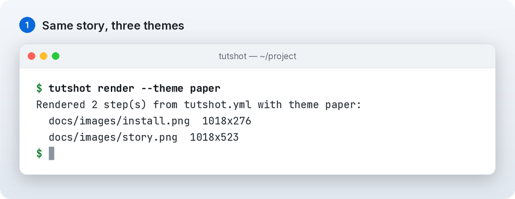
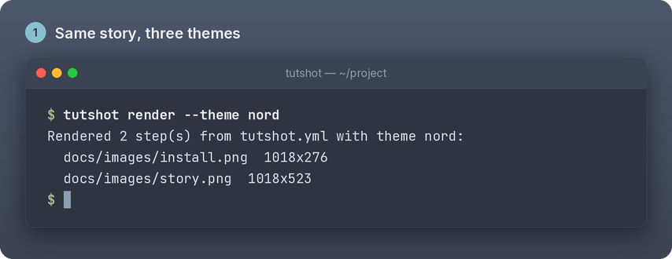

<p align="center">
  
</p>

<h1 align="center">tutshot</h1>

<p align="center">
  <b>Transformez une courte « histoire de commandes » YAML en captures README façon tutoriel.</b><br>
  Cadre de fenêtre, légendes numérotées et texte chinois et japonais de première classe — sans navigateur, sans enregistrement.
</p>

<p align="center">
  <a href="https://github.com/Xkongai/tutshot/actions/workflows/ci.yml"></a>
  <a href="LICENSE"></a>
  
</p>

<p align="center">
  <a href="README.md">English</a> | <a href="README.zh-CN.md">简体中文</a> | <a href="README.ja.md">日本語</a> | <a href="README.es.md">Español</a> | <a href="README.pt-BR.md">Português (Brasil)</a> | <b>Français</b> | <a href="README.de.md">Deutsch</a> | <a href="README.ko.md">한국어</a> | <a href="README.ru.md">Русский</a>
</p>

```bash
pip install tutshot
tutshot init          # writes tutshot.yml
tutshot render        # writes docs/images/{step}.png + story.png
```

Tout projet en ligne de commande a besoin, dans son README, de captures « voici à quoi ça ressemble ».
Les prendre à la main fait apparaître de vrais chemins de machine (`/Users/alice/dev/tmp3`), un prompt
encombré, et oblige à tout refaire quand la sortie change. **tutshot** vous permet d'écrire le tutoriel
*comme un script* : vous notez dans le YAML la commande, la sortie et la légende de chaque étape, et vous
obtenez des PNG nets et cohérents, que vous pouvez régénérer à tout moment.

## Sommaire

- [Ce qu'il fait](#ce-quil-fait)
- [Démo](#démo)
- [Installation](#installation)
- [Démarrage rapide en 30 secondes](#démarrage-rapide-en-30-secondes)
- [Référence du fichier d'histoire](#référence-du-fichier-dhistoire)
- [Thèmes](#thèmes)
- [Polices et texte CJK](#polices-et-texte-cjk)
- [tutshot face à freeze / vhs / termshot](#tutshot-face-à-freeze--vhs--termshot)
- [Python API](#python-api)
- [Développement](#développement)
- [Licence](#licence)

## Ce qu'il fait

- **Une histoire en entrée, des captures en sortie.** Un fichier YAML décrit un tutoriel en étapes
  numérotées ; tutshot écrit un PNG par étape (`install.png`, `init.png`, …) et un storyboard vertical, `story.png`.
- **Propre pour un tutoriel, par conception.** La sortie est écrite par vous, donc la documentation montre
  `~/project` et `./docs`, pas le répertoire dans lequel vous vous trouviez par hasard.
- **On dirait un vrai terminal.** Fenêtre façon macOS, avec les feux tricolores et une barre de titre, un
  prompt `$` vert, des commandes en gras, un curseur bloc, une ombre portée douce et des coins arrondis.
- **Texte net.** Tout est dessiné en 2× puis réduit ; `--scale 2` donne un rendu net façon Retina.
- **Le CJK est traité correctement.** Les caractères sont mesurés selon la chasse d'Asie orientale
  (中文 / 日本語 occupent deux colonnes), donc le retour à la ligne et l'alignement restent justes. Si
  l'histoire contient du CJK et qu'aucune police CJK n'est installée, tutshot s'arrête avec une indication
  d'installation au lieu d'écrire des carrés (tofu).
- **Petit et hors ligne.** Python pur, au-dessus de Pillow, PyYAML et Typer. Pas de Chrome, pas de Playwright,
  pas d'asciinema, pas de réseau, pas de clés d'API.

## Démo

Voici le storyboard que tutshot a généré à partir de [`tutshot.yml`](tutshot.yml) dans ce dépôt
(`tutshot render`) :

<p align="center">
  
</p>

Chaque étape est aussi enregistrée à part, prête à être placée à côté de la section correspondante du README :

<p align="center">
  
</p>

Et la même chose avec du texte chinois et japonais ([`examples/hello.yml`](examples/hello.yml), thème `nord`, prompt personnalisé) :

<p align="center">
  
</p>

## Installation

```bash
pip install tutshot
```

Depuis un clone (pour le développement ou le code le plus récent) :

```bash
git clone https://github.com/Xkongai/tutshot.git
cd tutshot
pip install -e .
```

Nécessite Python 3.11+. Vérifiez la version avec `tutshot --version`.

## Démarrage rapide en 30 secondes

```bash
cd ~/project
tutshot init                 # 1. write a sample tutshot.yml
$EDITOR tutshot.yml          # 2. replace the sample steps with your own commands and output
tutshot render               # 3. PNGs land in docs/images/
```

Référencez-les ensuite depuis votre README :

```markdown

```

Options utiles :

| Commande | Rôle |
| --- | --- |
| `tutshot init [path]` | Écrit une histoire d'exemple (par défaut `./tutshot.yml` ; `--force` pour écraser) |
| `tutshot render [file]` | Rend `file` (par défaut `tutshot.yml`) en un PNG par étape plus `story.png` |
| `  --out DIR` / `-o` | Répertoire de sortie (par défaut `docs/images`) |
| `  --theme dusk\|paper\|nord` | Remplace le thème défini dans l'histoire |
| `  --scale 2` | Sortie Retina (pixels en 2×) |
| `  --no-sheet` | N'écrit pas `story.png` |
| `tutshot fonts` | Affiche les polices à chasse fixe / CJK / d'interface qui ont été trouvées |
| `tutshot --version` | Affiche la version |

Codes de sortie : `0` ok, `2` histoire ou options non valides, `3` rendu impossible (par exemple une police CJK manquante).

## Référence du fichier d'histoire

```yaml
title: tutshot           # window title prefix (default: bash)
theme: dusk              # dusk | paper | nord (default: dusk; --theme overrides)
cwd: ~/project           # display-only path in the title bar (default: ~)
prompt: user@tutorial    # optional; shows "user@tutorial:~/project$ " instead of "$ "
width: 88                # terminal columns, 40–200 (default: 88 → ~1018 px wide images)
caret: true              # draw a final prompt with a block caret (default: true)
steps:
  - id: init             # required; file name → init.png (letters, digits, - and _)
    caption: Start a tutorial story   # optional; shown above the window with a step number
    command: tutshot init             # required; may span several lines
    output: |                         # optional; may be empty
      Wrote tutshot.yml
```

Règles que tutshot vérifie pour vous, avec un message d'erreur clair qui désigne l'étape :

- `id` et `command` sont obligatoires ; les id doivent être uniques (sans tenir compte de la casse) et correspondre à `[A-Za-z0-9_-]+`.
- `story` est réservé au fichier du storyboard.
- Les clés inconnues sont refusées avec une suggestion (`ouput` → *did you mean 'output'?*).
- Les lignes longues sont coupées selon la largeur d'affichage ; les commandes longues continuent avec un retrait de deux espaces.
- Les tabulations sont étendues à 4 colonnes.

> **Conseil :** gardez une sortie honnête. Collez la vraie sortie de votre outil et ne retouchez que ce
> qu'un lecteur ne devrait pas voir — chemins absolus de la machine, noms d'utilisateur, durées qui changent à chaque exécution.

## Thèmes

| `dusk` (par défaut) | `paper` | `nord` |
| --- | --- | --- |
|  |  |  |
| Inspiré de GitHub Dark | Clair, conçu pour les README clairs | La palette Nord |

Toutes les images ont des coins arrondis transparents, elles se posent donc bien sur les modes clair et sombre de GitHub.

## Polices et texte CJK

tutshot cherche des polices dans les dossiers habituels de Linux, macOS et Windows :

- **Texte du terminal :** JetBrains Mono, Cascadia Mono/Code, Menlo, Consolas, Noto Sans Mono,
  DejaVu Sans Mono, Liberation Mono, Ubuntu Mono, Source Code Pro, …
- **CJK :** Noto Sans (Mono) CJK, Source Han Sans, PingFang, Hiragino Sans GB, Microsoft YaHei,
  Yu Gothic, WenQuanYi Micro/Zen Hei, Droid Sans Fallback, Songti, SimSun, …
- **Barre de titre et légendes :** Inter, Segoe UI, Helvetica, Noto Sans, DejaVu Sans, … (à défaut,
  la police à chasse fixe).

Lancez `tutshot fonts` pour voir laquelle a été retenue. Pour forcer une police, faites pointer une variable d'environnement vers le fichier :

```bash
TUTSHOT_MONO_FONT=~/fonts/JetBrainsMono-Regular.ttf \
TUTSHOT_CJK_FONT=/usr/share/fonts/opentype/noto/NotoSansCJK-Regular.ttc \
tutshot render
```

`TUTSHOT_UI_FONT` fonctionne de la même façon, et `TUTSHOT_FONT_DIRS` ajoute des dossiers à la recherche.

Les histoires en alphabet latin seul fonctionnent avec les seules polices DejaVu ou Liberation. Les histoires
avec du texte chinois, japonais ou coréen exigent une police CJK ; sans elle, tutshot s'arrête ainsi :

```text
error: no CJK font found. Install Noto Sans CJK, e.g. `sudo apt install fonts-noto-cjk` ...
```

Les emoji ne sont pas pris en charge dans la v0.1 (il n'y a pas de rendu d'emoji en couleur).

## tutshot face à freeze / vhs / termshot

Ils résolvent des problèmes différents, et ils vont bien ensemble :

- Vous voulez une **capture au pixel près d'un terminal en direct**, couleurs réelles comprises ? Utilisez
  [freeze](https://github.com/charmbracelet/freeze) ou [termshot](https://github.com/homeport/termshot).
- Vous voulez un **enregistrement animé** d'une session ? Utilisez [vhs](https://github.com/charmbracelet/vhs) ou asciinema.
- Vous voulez **storyboarder un tutoriel** — plusieurs étapes numérotées avec légendes, des chemins propres et une sortie
  que vous maîtrisez, régénérée depuis un fichier texte en CI ? C'est le rôle de tutshot.

Ce que tutshot ne fait *pas* (pour l'instant) : exécuter vos commandes, conserver les couleurs ANSI d'une vraie
sortie, ni colorer la syntaxe. Vous écrivez la sortie ; tutshot la dessine.

## Python API

```python
from tutshot import load_story, render_story

story = load_story("tutshot.yml")
paths = render_story(story, "docs/images", theme="paper", scale=2)
```

`parse_story(dict)` valide des données déjà chargées, et `tutshot.render.Renderer` vous donne les
images individuelles de la fenêtre ou de la carte comme objets Pillow (l'aperçu pour les réseaux de ce
dépôt est construit ainsi — voir [`examples/social_preview.py`](examples/social_preview.py)).

## Développement

```bash
python -m venv .venv && source .venv/bin/activate
pip install -e ".[dev]"
pytest -q
bash examples/build_docs.sh    # regenerate every image in docs/images/
```

Voir [CONTRIBUTING.md](CONTRIBUTING.md) et [CHANGELOG.md](CHANGELOG.md).

## Licence

[MIT](LICENSE) © 2026 Xkongai
